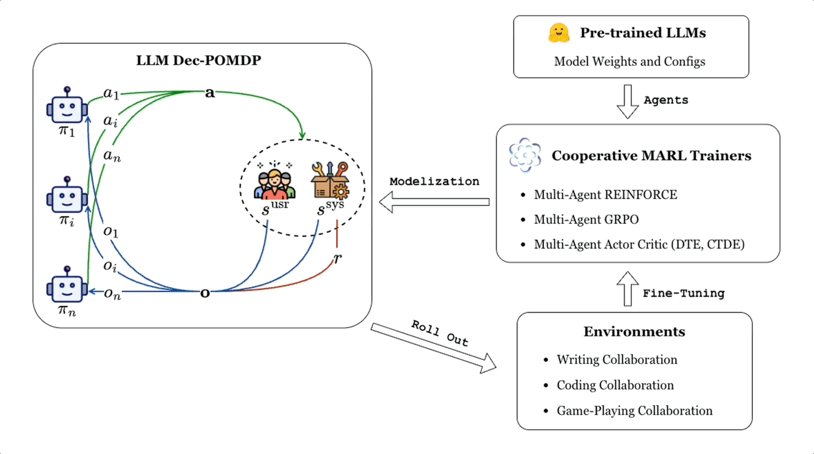

# CoMLRL: An Implementation Study


This repo is my study of the code behind **Learning Decentralized LLM Collaboration with Multi-Agent Actor Critic** (ICML 2026), based on the authors' official **CoMLRL** implementation.

I worked through the released actor-critic code by hand, traced the main training pipeline, looked at how the centralized and decentralized critics differ, and wrote down what I found about the implementation's constraints, validation points, failure guards, and what it takes to run on modest hardware. The details are in [`docs/IMPLEMENTATION_NOTES.md`](docs/IMPLEMENTATION_NOTES.md).

> **On credit:** The research, algorithms, code, datasets, experimental setup, and reported results all belong to the original authors. I'm not claiming the method or the codebase.
<p align="center">
  
</p>

---

## What the paper is about

CoMLRL looks at how several LLM agents can learn to collaborate using multi-agent reinforcement learning. The paper focuses on actor-critic training for decentralized collaboration and compares two critic setups:

- **CoLLM-CC** uses a centralized critic.
- **CoLLM-DC** uses decentralized critics.

The idea is to use learned value estimates as a more informative training signal than pure Monte Carlo policy gradients give you, especially for multi-turn and longer-horizon interaction. The two variants differ mainly in what the critic can see during training. The critic is only used for training, so the actors can still act independently afterward.

## How the code is laid out

The paper-reference release centers on a small set of files:

```text
comlrl/
├── models/
│   └── actor_critic.py
├── trainers/
│   ├── iac.py
│   ├── maac.py
│   ├── magrpo.py
│   ├── mareinforce.py
│   ├── maremax.py
│   └── marloo.py
└── utils/
```

For this study I concentrated on `actor_critic.py`, `iac.py`, and `maac.py`.

A run goes like this: a dataset item is formatted into an agent-specific prompt and tokenized, the LLM generates a rollout, rewards are computed, values are estimated, the TD target or return is built, advantages are prepared, and the actor and critic are optimized before evaluation. In multi-turn training, an external transition mechanism updates the interaction state between turns.

## The model layer

`comlrl/models/actor_critic.py` has the shared pieces the trainers rely on: `ActorCriticOutput`, `ValueHead`, and `CausalLMWithValueHead`. The value head turns transformer representations into a scalar value estimate, and the wrapper lets you attach one to a causal LM's backbone, which is how you get a shared actor/value model.

That sets up a trade-off. A separate critic keeps actor and critic cleanly apart but costs extra model memory. A shared model with a value head reuses the same backbone and has a smaller extra footprint.

## Independent Actor-Critic (IAC)

`comlrl/trainers/iac.py` implements IAC. Each agent gets its own actor and critic, and the flow is prompt formatting, rollout generation, reward computation, policy and critic evaluation, advantage preparation, the update, and evaluation. It supports both critic styles above: a dedicated value model per agent (more memory), or a value head on the actor backbone (less).

## Multi-Agent Actor-Critic (MAAC)

`comlrl/trainers/maac.py` implements MAAC. The difference from IAC is what the critic sees. Actors work from their own histories and prompts, while the centralized critic is built from joint information across agents. That makes the centralized-training, decentralized-execution assumption concrete in the code.
<p align="center">
  
</p>

## Rollout generation

This is the first heavy step. The code formats and tokenizes the prompt, generates a completion, splits prompt tokens from response tokens, records sequence statistics, computes reward information, and evaluates the trajectory. Generation is controlled by `max_new_tokens`, `temperature`, `top_p`, `top_k`, and `num_return_sequences`, and there are explicit checks for invalid or empty sequences.

## Rewards and values

The trainers take a configurable reward function, and the reward path maps whatever it returns into the structure the multi-agent loop needs. The rollout data then feeds reward assignment, value estimation, return construction, advantage preparation, and both optimizers. Keeping those separate matters because the reward signal and the learned value estimate play different roles in the update.

## Advantages

The update uses value information stored with each rollout. The advantage comes from the value target minus the old value estimate. Advantages can be normalized before the policy update, the policy step uses the generated sequence together with its advantage, and the critic trains toward its value target.

## Multi-turn training

When `num_turns > 1`, an `external_transition` is required, and it decides how the interaction state evolves between turns. Multi-turn configs are also limited to one return sequence per prompt. That limit is enforced by configuration validation, so it isn't a hidden runtime assumption.

---

## What I verified in the code

I'm not reproducing the ICML experiments here. This table covers what can be established directly from the released code and its guards.

| Area | Finding | Status |
|---|---|---|
| IAC configuration | Invalid agent and turn configurations are rejected | Verified |
| Multi-turn configuration | An invalid multi-return setup is rejected | Verified |
| External transition | Required for multi-turn training | Verified |
| MAAC critic | MAAC requires critic configuration | Verified |
| Critic type | Supported critic targets are explicitly constrained | Verified |
| Rollout generation | An empty completion counts as an invalid rollout | Verified |
| Reward handling | Reward outputs are checked and aligned with the rollout structure | Verified |
| Advantage path | Value target and stored value go into the advantage | Verified |
| Numerical stability | Non-finite training quantities are checked | Verified |
| Centralized critic | Joint information builds the MAAC critic input | Verified |

These are findings about the implementation, not benchmark measurements.

## Hardware

```text
OS    Windows 11
CPU   Intel Core i7
GPU   NVIDIA GeForce RTX 3050 6GB
RAM   16GB
```

The paper-scale experiments need far more compute than this machine has. The paper reports CoopHE training memory of roughly 126.3 GB of VRAM for CoLLM-DC and 107.4 GB for CoLLM-CC. Those figures come from the authors' infrastructure, not from my laptop.

So a hardware-matched reproduction of the full training setup isn't realistic on a 6 GB card. The code is still very much worth studying here through source tracing, config validation, trainer-path analysis, lightweight tests, small synthetic experiments, inspecting the model and value head, following the reward flow, and analyzing failure conditions.

## Results reported in the paper

These are **author-reported** numbers, not ones I reproduced.

| Method | TLDR | ArXiv | CoopHE Pass@1 | StrBuild IoU | HouseBuild IoU |
|---|---:|---:|---:|---:|---:|
| MAGRPO | 93.5 | 93.1 | 74.3 | 50.6 | 50.9 |
| CoLLM-DC | 95.4 | 94.1 | 59.1 | 44.6 | 46.8 |
| CoLLM-CC | 95.2 | 95.0 | 75.2 | 68.5 | 52.7 |

The pattern the paper reports is that CoLLM-DC holds up against CoLLM-CC on short-horizon writing tasks, while CoLLM-CC does clearly better on CoopHE and the Minecraft tasks, and the gap widens as tasks get longer or harder to optimize. All of that comes from the original experiments.

## What it costs

The paper also reports training overhead on CoopHE:

| Method | Training time | VRAM |
|---|---:|---:|
| MAGRPO | 4.5 H200 hours | 93.8 GB |
| CoLLM-DC | 13.4 H200 hours | 126.3 GB |
| CoLLM-CC | 11.1 H200 hours | 107.4 GB |

A learned critic gives a better value-based training signal, but it adds model computation and memory. The payoff is better learning behavior and performance in multi-agent interaction, not lower training cost.

## Paper release vs. current checkout

The paper-reference implementation is `v1.3.2`. The checkout I have locally is newer. Comparing the source shows substantial changes since then, including a reorganized actor-critic layer, runtime and device scheduling, additional preference trainers, more utilities, and further trainer changes.

Because of that, I treat `v1.3.2` as the paper-reference snapshot and the current checkout as a later upstream version. I don't attribute later changes to the ICML 2026 implementation.

## What I did and didn't do

I worked through the original implementation by hand and traced the IAC and MAAC execution paths. I looked at how the actor and value head fit together, followed rollout generation, examined reward and return handling, and traced how advantages are computed. I compared what the centralized and decentralized critics see, noted the explicit configuration and numerical failure guards, and assessed what's feasible on a 6 GB GPU. I left the original actor-critic source unchanged.

I'm not claiming a full reproduction of the benchmark suite, the five-run results, the paper-scale training curves, the reported H200 training times or VRAM usage, or a hardware-matched replication of the authors' setup.

## Questions this raised

These are questions the code and paper made me curious about, not validated claims.

1. How much of the centralized critic's edge comes from joint information versus better value estimation?
2. How does critic stability degrade as the number of turns grows?
3. How small can a critic get before most of the benefit disappears?
4. Can decentralized critics be stabilized with parameter sharing or stronger value regularization?
5. Can actor-critic training become practical on consumer hardware with smaller critics, quantization, or parameter-efficient training?

## Repository structure

```text
.
├── comlrl/                    # Original CoMLRL implementation
├── docs/
│   └── IMPLEMENTATION_NOTES.md
├── examples/                  # Original examples
├── tests/                     # Original test suite
├── CITATION.cff
├── CONTRIBUTING.md
├── LICENSE
├── requirements.txt
├── setup.py
└── README.md
```

## Attribution

This repo builds on the official CoMLRL implementation of **Learning Decentralized LLM Collaboration with Multi-Agent Actor Critic** by Shuo Liu, Tianle Chen, Ryan Amiri, and Christopher Amato (ICML 2026).

- Official repository: https://github.com/OpenMLRL/CoMLRL
- Paper: https://proceedings.mlr.press/v306/liu26k.html

The research, implementation, datasets, and reported experiments belong to the original authors. This is an implementation study, not a claim of original algorithmic contribution.
